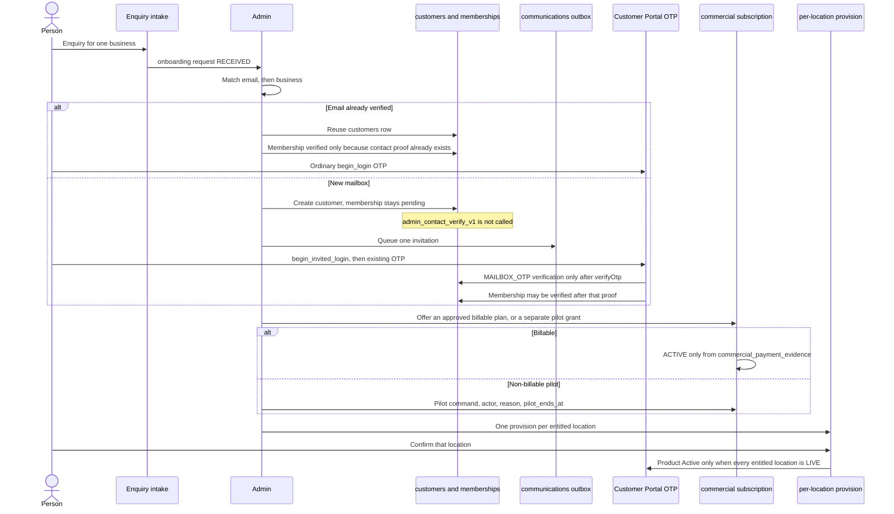

# 02A — Customer journey

Status: **proposed operating model**, revised against review comment `6559957225`. Admin-approved onboarding. No invitation email is sent by this PR. Admin approval does not verify an email and does not create a session.

## Sequence

Enquiry intake can keep using `create_general_enquiry_v1`. The new request stores `enquiry_id`. It does not call `admin_enquiry_convert_v1`, because that function only creates a case or a monitoring request.

## Steps

### 1. Enquiry

The payload already carries name, email, phone, and business name (`admin_private.valid_enquiry_v1`). Admin sees a Telloya or Complete request beside the existing enquiry queue. Outstanding steps are the request `state` plus the latest subscription, entitlement, allocation, and provision states. A failure is the last command response and the last event `reason`, not a separate inbox.

The same email may open two unmatched requests. Deduplication is the enquiry id, and after a business is matched, `(business_id, plan_family)`. It is not `(email_snapshot, product_code)`.

### 2. Admin review and match

Match order:

1. `lower(email)` against `customers_email_lower_idx`.
2. If a row exists and `verified_current_email_v1` equals that email, reuse the customer. Do not insert another. The invited OTP functions refuse this person. They sign in with `customer_portal_begin_login_v1`.
3. If the row exists but the email is not verified, the request stays `MAILBOX_REQUIRED`. Do not call `admin_contact_verify_v1`. That command stores an administrator evidence string of 10 to 1000 characters. It does not prove mailbox control, and `begin_login` would still be the wrong first step if the row had been forged that way.
4. If no row exists, create one with `admin_record_save_v1`. Leave `customer_contact_verifications` empty. The Auth user is still created later by `ensureCustomerAuthIdentity` during real OTP login, not during approval.

Business match uses the existing business and location records. If the business is new, create the business, then each location. Membership uses `admin_membership_save_v1`.

`admin_membership_save_v1` refuses `verified` unless some contact is already verified. For a new mailbox the membership stays `pending` until the invited OTP has written `MAILBOX_OTP`. Membership evidence is not mailbox proof. For an already verified email, the membership may be verified in the match step, because the contact proof already exists. A second customer for the same business is another membership row, not another business.

### 3. Offer

A billable offer references one `APPROVED` plan version whose `amount_minor`, `currency`, `tax_behaviour`, and `terms_ref` are all set. Those values are copied onto the subscription and items and then frozen. Draft, unpriced, or untaxed plans cannot be offered as billable. There is no `TRIAL` cadence. The offer creates `commercial_subscriptions` in `OFFERED` with `grant_kind = BILLABLE` and one item per component. It does not call Stripe and it does not insert `commercial_payment_evidence`.

A non-billable pilot is a different command, not a cheaper offer. It requires `admin_session_v1`, a reason, and `pilot_ends_at`. `amount_minor` stays null. `currency` is still `GBP`. No payment-evidence row is allowed. Prices, pilot length, and location caps remain pending under D5. This journey does not choose them.

### 4. Invitation

Queue one `communications` row and one `SEND_EMAIL` outbox event keyed `onboarding-invite:<request_id>:v<send_count>`. A second click with the same key does not send a second email.

The message tells the person which address to use. It does not contain a session cookie, a customer id, or a return-to URL. If a one-time secret is included, only its hash is stored, it expires, and an unknown hash returns the same generic unavailable result as an expired hash. The secret alone returns no data and inserts no session.

Admin approval does not insert `customer_portal_sessions`, does not call `customer_portal_finish_otp_v1`, and does not set `mailbox_proved_at`.

### 5. First login and later login

Two entrances, one session table.

| Person | Entrance | What gets written |
| --- | --- | --- |
| Email not yet in `customer_contact_verifications` | `customer_portal_begin_invited_login_v1`, then the existing Supabase OTP | After `verifyOtp`, `customer_portal_finish_invited_otp_v1` inserts `proof_kind = MAILBOX_OTP`, evidence the challenge hash, `verified_by` null. It consumes the invitation and inserts a normal portal session. |
| Email already verified | Ordinary `customer_portal_begin_login_v1` | No new verification row. The invitation is consumed when that session's email snapshot matches. The invited functions return the same `unavailable` result they use for a bad hash. |

`begin_login`, `confirm_otp_sent`, resend, attempt, and `finish_otp` all call `customer_portal_email_current_v1`, which requires `verified_current_email_v1`. They stay as they are and will keep rejecting this new customer. The invited functions write the same challenge and session tables, share `customer_portal_reserve_send_v1`, and keep the five-attempt cap. They do not call those five functions.

`verified_by` is `NOT NULL` today, and there is no `proof_kind` column. Mailbox proof needs the later migration in the data model. Until that migration, nothing in the admin session may insert a verification row to paper over the gap.

The invited finish checks `customer_portal_auth_identity_current_v1`, inserts the verification, and only then inserts the session. Idle timeout, absolute lifetime, and sign-out stay on `customer_portal_sessions`. The next sign-in uses `begin_login` only. An action-session cookie is still not a portal session.

### 6. Payment or pilot

| Path | Subscription state | Entitlement |
| --- | --- | --- |
| Checkout not finished | `PAYMENT_PENDING` | `PENDING` |
| `checkout.session.completed` or Stripe subscription `active`, with no paid-invoice evidence | stays `PAYMENT_PENDING` | stays `PENDING` |
| Payment failed | `PAST_DUE` | stays `PENDING`, or leaves `ELIGIBLE` if a renewal fails. `PAST_DUE` still occupies the business. |
| `commercial_payment_evidence` for a processed paid invoice | `ACTIVE` | `ELIGIBLE` for that evidence period, one row per location |
| Non-billable pilot command | `ACTIVE` with `pilot_ends_at` | `ELIGIBLE` until `eligible_to`. Portal copy says pilot, never paid. |
| Pilot date passed, or paid period ended with no new evidence | `ENDED` | `EXPIRED`. Guard allocations for that subscription become `LAPSED`. |

The paid-invoice writer is 02G. It must share `stripe_event_receipts` idempotency. It must not write `guard_billing` and must not call `guard_apply_invoice_paid_v1` or `guard_set_billing_entitlement_v1`. It must not point at `payment_receipts`, because those rows belong to Recovery obligations.

### 7. Provisioning and activation

Telloya setup is one `service_provisions` row per entitled location. Each location has its own profile, agent, number, forwarding, test, and confirmation timestamps, and its own `provider_binding_ref` once a later provider phase sets it. Two locations must not share that ref. The customer can see the current step for each location after they are eligible to log in. They cannot see provider credentials.

`LIVE` is per location, and only after that location's customer confirmation. The product phrase Active is returned only when every entitled location is `LIVE`. Location A `LIVE` and location B `NUMBER_REQUIRED` is partial setup.

Guard setup is not this table. A Complete Guard seat is a `bundle_guard_allocations` row. It does not create `guard_coverages`, does not set `guard_billing`, and does not call `guard_activate_v1`. The portal must not say Guard can be activated from Complete until the gated Guard migration in the data model has been applied.

### 8. Portal access

Until `customer_portal_products_v1` exists, the Phase 1 hub stays as shipped. The later read returns one row per entitled location plus an aggregate. The aggregate is not Active while any entitled location is short of `LIVE`. It does not replace `/portal` and it does not invent `/portal/telloya`.

## Account invitation: what exists and what is new

| Need | Already exists | Still required |
| --- | --- | --- |
| Find a person by email | Unique `lower(email)` | Match step in the onboarding command |
| Prove a mailbox | Supabase `verifyOtp`, the login challenge table, and the portal session table | Invited begin, confirm, resend, attempt, and finish. They must not call the five current functions, which all require `verified_current_email_v1`. A new `proof_kind` column has to allow `verified_by` null for `MAILBOX_OTP`. |
| Record an admin note about a contact | `admin_contact_verify_v1` | Leave it for admin-recorded evidence. Do not use it as the first proof of a new mailbox. |
| Sign in afterwards | `customer_portal_begin_login_v1`, idle, absolute expiry, sign-out | No change once the verification row exists |
| Create the Auth user | `ensureCustomerAuthIdentity` at login | Do not call it from the admin approval command |
| Scoped secret link | `customer_actions` secret hash and expiry | Wrong table: kinds are case, quote, payment, and Guard coverage, and they require `customer_id` plus that target |
| Send mail once | `communications` and unique outbox `event_key` | A new template and claim reason |
| Track Telloya setup | Nothing | `onboarding_requests`, invitations, per-location entitlement and provision |

## Example scenarios

The names below are labels for rows, not people. Financial record means where money is stored. One occupying commercial subscription means one `commercial_subscriptions` row in `ACTIVE`, `PAUSED`, `PAST_DUE`, or `CANCEL_AT_PERIOD_END` for that `business_id`.

### Two businesses, one customer

Customer row C is already verified. C has a verified membership on Business North and later a second membership on Business South.

North completes a Telloya enquiry. After match, one open onboarding request exists for `(North, VOICE)`. One occupying Telloya subscription is billed to C and serves North. South then enquires for Complete. A second request is allowed because `business_id` differs. A second occupying subscription is allowed for the same reason. The rejected unique key `(email_snapshot, product_code)` would have blocked South. C still has one `customers` row and one portal login.

An incoming Complete offer may also exist on North while North's Telloya row still occupies, but only with `succeeds_subscription_id` pointing at that Telloya row. North cannot have two occupying rows. The switch command sets the old Telloya `eligible_to` and the new Complete `eligible_from` to the same timestamp.

### Several locations, different Telloya states

North's Telloya plan includes two locations, High Street and Market. The subscription is one row. The item quantity is 2, checked against `quantity_limit_snapshot`. Each location gets its own `product_entitlements` row (`location_id` not null) and its own `service_provisions` row.

High Street has all six timestamps, a unique `provider_binding_ref`, customer confirmation, and state `LIVE`. Market is `NUMBER_REQUIRED` and has a null binding. The portal returns High Street as live for that location and Market as setup. The business aggregate is not Active. A second open provision for High Street is rejected by the partial unique index on `location_id`.

### Complete upgrade across Guard locations

South already pays for Guard at Dock and at Yard. Each location has its own open `guard_subscriptions` row and its own non-ended `guard_coverages` row. Paid-through for those coverages is `guard_billing`, written by `guard_apply_invoice_paid_v1`.

Admin offers Complete for South. The commercial subscription has no `reconciled_guard_subscription_id`. Instead there are two `bundle_guard_allocations`:

| Location | Allocation state | Superseded Guard subscription | Coverage link |
| --- | --- | --- | --- |
| Dock | `RECONCILING` | Dock's open `guard_subscriptions` id | null, check-forced in 02B |
| Yard | `RECONCILING` | Yard's open `guard_subscriptions` id | null, check-forced in 02B |

Each allocation's `paid_through_at` is the Complete period end. That timestamp is not copied into `guard_billing`. No `guard_subscription_invoices` row is inserted. `guard_set_billing_entitlement_v1` is not called.

The existing Guard cancel or credit command runs once per location. Dock can reach `READY_FOR_GUARD_SCHEMA` when Dock's Guard subscription is `CANCELED` or `ENDED`, while Yard stays `RECONCILING`. Until both are closed, Complete must not start a second Guard charge for the one that is still open. The open-subscription indexes already forbid a second open `guard_subscriptions` row and a second non-ended coverage on the same location. The allocation unique index forbids a second open seat on that location. The quantity cap forbids a third location when the pinned Guard item allows two.

`READY_FOR_GUARD_SCHEMA` is not activation. `guard_activate_v1` still has no legal origin for a Complete-funded location: `DIRECT_GUARD` needs a `RELAUNCH_GUARD` service order, and `INCLUDED_RECOVERY` needs a recovery case and is pinned to 30 days. The portal says the Guard seat is waiting. It does not say monitoring is on.

### Subscription expiry

Complete on South is `ACTIVE` until `current_period_end`. No new `commercial_payment_evidence` arrives. The expiry command sets the subscription `ENDED`, every Complete entitlement `EXPIRED`, and both allocations `LAPSED`. Telloya provisions leave `LIVE`. `guard_billing` is unchanged because 02B never wrote it. `guard_activate_v1` is not involved.

A North pilot works the same way with `pilot_ends_at`. There is no evidence row to extend. The portal says the pilot has ended. It does not say the invoice failed, and it does not say the service is Active.

`PAST_DUE` is the billable failure before expiry. It occupies the business, entitles nothing, and still does not suspend Guard by deleting a coverage. Telloya provisions that were `LIVE` move to `SUSPENDED`.

### First-time login and an already verified email

| Step | Unknown address, first Complete enquiry | C, already verified, adding South |
| --- | --- | --- |
| Admin match | No `customers` row. Create the row. Do not insert `customer_contact_verifications`. | `lower(email)` hits C. Reuse the row. |
| Membership | `pending`. `admin_membership_save_v1` would refuse `verified`. | May be `verified` for South, because C's email proof already exists. |
| Invitation | Hash stored. Mail queued. `mailbox_proved_at` null. | Same invitation record, so the request is auditable. The invited functions will refuse C. |
| Sign-in | `begin_invited_login` sends the existing OTP. Wrong or expired hash returns generic unavailable and no session. | `begin_login` only. Unknown email still returns ineligible, as it does today. |
| After OTP | `finish_invited_otp` writes `MAILBOX_OTP`, consumes the invitation, opens one portal session. | Existing finish path opens the session. Invitation consumed because the session email matches. No second customer. |
| Next day | `begin_login` works. Invited functions now refuse this address. | Unchanged. |
| What never happens | Admin approval does not call `admin_contact_verify_v1`. The hash alone does not insert `customer_portal_sessions`. | The invited path does not mint a second verification or a second Auth user. |

## Other catalogue cases

| Scenario | Financial record | Commercial subscription | Entitlement and operation |
| --- | --- | --- | --- |
| Recovery only | `payment_obligations` on the case's service order | None | No new row. Portal Recovery stays case-owned. |
| Guard only | `guard_subscriptions` and `guard_subscription_invoices`. Paid-through is `guard_billing`. | None | Coverage and activation stay on Guard. A `GUARD_COVERAGE` entitlement link can be added later so My Products can describe it. It must not bypass readiness. |
| Telloya only | One commercial subscription, later one Stripe subscription | One Telloya plan, `grant_kind = BILLABLE` | One entitlement and one provision per location. Billed once for the business. |
| Telloya and Guard bought separately | Guard ledger plus one Telloya commercial subscription | Telloya only, `plan_family = VOICE` | Telloya entitlements per location. Guard stays on its coverage. A Complete offer for that business must set `succeeds_subscription_id` and cannot occupy the business beside Telloya. |
| Complete bundle | One commercial subscription for the bundle price | One Complete plan with Telloya and Guard items | Telloya provisions per location. Guard seats are allocations, not coverages, until the gated Guard PR. |
| Recovery customer adds Complete | Recovery obligations stay. New Complete subscription. | One for that business | Same customer id. Membership rules above. Portal login unchanged. |
| One customer, several businesses | Each business has its own subscription and its own evidence or pilot | One occupying row per business | See the North and South example. |
| Several users, one business | One billing customer on the subscription | One occupying row | Other verified members can use an eligible location. They do not see invoice amounts unless a later decision says so. They do not see another business. |
| Payment pending | Subscription `PAYMENT_PENDING` | One incoming or occupying row, as the state table allows | Entitlements `PENDING`. Provisions may be drafted. None can be `LIVE`. |
| Paid, not provisioned | Commercial `ACTIVE` from evidence | One | Entitlements `ELIGIBLE`. A location without `LIVE` keeps the product off Active. |
| Paused or suspended | Commercial `PAUSED` and/or a location provision `SUSPENDED` | Kept | That location stops. Other locations stay as they are. Rows remain. |
| Cancel at period end | `CANCEL_AT_PERIOD_END` | Occupies until period end | Access continues until `eligible_to`. Then `EXPIRED` and allocations `LAPSED`. |
| Immediate revocation | Admin command with reason | `CANCELED` | Entitlements `REVOKED` immediately. Guard monitoring stops only through the existing Guard cancellation command, and only for coverages that already exist. 02B has none to delete. |
| Bundle downgrade | The Complete row ends or is succeeded. A Telloya row opens only through `succeeds_subscription_id` and the same-timestamp handoff. | One occupying row after the handoff | Open allocations above the new quantity are refused until a location is `ENDED`. Telloya provisions can move to the new subscription's entitlements in that same transaction. |
| Expired pilot | `ENDED`, `amount_minor` still null | Kept as history | Entitlement `EXPIRED`. Portal does not show Active or paid. |

Recovery plus Telloya is the "Recovery customer adds Complete" shape with a Telloya plan instead: the case is untouched and the new product is a subscription. They share the customer and, when it is the same business, the membership. They do not share a financial record.

## Customer-visible progress

After login, a later portal read can show, per location and as an aggregate:

- no products yet
- invited, payment not started
- payment pending or failed
- paid, or pilot ending on a date, plus the setup step for each location that is not `LIVE`
- live at a location
- partial, when entitled locations disagree
- paused, cancelled, or expired
- Guard seat reserved, reconciling, or waiting on the Guard schema change
- unavailable, when the read fails

"Active" is reserved for the operational aggregate: every entitled Telloya location is `LIVE`, or an existing Guard coverage is `ACTIVE` under the current readiness function. Commercial `ACTIVE` is shown as paid or as pilot in force. A Complete Guard allocation is never shown as monitoring on.
