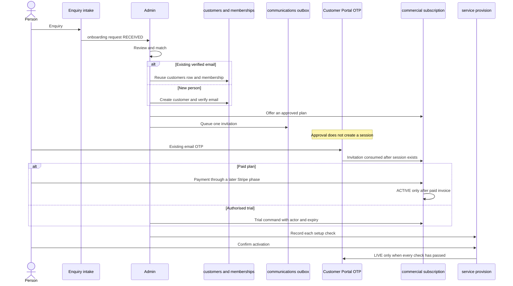

# 02A — Customer journey

Status: **proposed operating model**. Admin-approved onboarding. No invitation email is sent by this PR.

## Sequence

Enquiry intake can keep using `create_general_enquiry_v1`. The new request stores `enquiry_id`. It does not call `admin_enquiry_convert_v1`, because that function only creates a case or a monitoring request.

## Steps

### 1. Enquiry

The payload already carries name, email, phone, and business name (`admin_private.valid_enquiry_v1`). Admin sees a Telloya or Complete request beside the existing enquiry queue. Outstanding steps are the request `state` plus the latest subscription, entitlement, and provision states. A failure is the last command response and the last event `reason`, not a separate inbox.

### 2. Admin review and match

Match order:

1. `lower(email)` against `customers_email_lower_idx`.
2. If a row exists and `verified_current_email_v1` equals that email, reuse the customer. Do not insert another.
3. If the row exists but the email is not verified, stop in `IDENTITY_REQUIRED` until an admin records verification through the existing contact-verification command. Do not send a portal OTP yet.
4. If no row exists, create one with `admin_record_save_v1`, then record the email verification in the same admin session. Membership uses `admin_membership_save_v1`. The Auth user is still created later by `ensureCustomerAuthIdentity` during real OTP login, not during approval.

Business match uses the existing business and location records. If the business is new, create business then location, then a `verified` membership for this customer. Membership evidence and `verified_by` stay mandatory. A second customer for the same business is another membership row, not another business.

### 3. Offer

An offer references one `APPROVED` plan version whose `amount_minor` is not null, unless the plan cadence is `TRIAL`. Draft or unpriced plans cannot be offered. The offer creates `commercial_subscriptions` in `OFFERED` and the component items. It does not call Stripe.

### 4. Invitation

Queue one `communications` row and one `SEND_EMAIL` outbox event keyed `onboarding-invite:<request_id>:v<send_count>`. A second click with the same key does not send a second email.

The message tells the person to sign in to the existing Customer Portal with that email. It does not contain a session cookie, a customer id, or a return-to URL. If a one-time secret is included, only its hash is stored, it expires, and the public page exchanges it for "we recognised this invitation" after OTP succeeds. The secret alone returns no data.

Admin approval does not insert `customer_portal_sessions` and does not call `customer_portal_finish_otp_v1`.

### 5. Verified login

Existing portal rules stay in force:

- `customer_portal_begin_login_v1` requires a customer and a verified current email.
- Finish requires the Auth identity to match.
- Idle and absolute expiry stay as implemented.
- An action-session cookie is still not a portal session.

An existing Recovery or Guard customer uses the same login. The invitation is consumed when that session's email snapshot matches the invitation. No second account is created.

### 6. Payment or trial

| Path | Subscription state | Entitlement |
| --- | --- | --- |
| Checkout not finished | `PAYMENT_PENDING` | `PENDING` |
| Payment failed | `PAST_DUE` | stays `PENDING` or moves back from `ELIGIBLE` if a renewal fails |
| Confirmed paid invoice | `ACTIVE` | `ELIGIBLE` for the paid window |
| Authorised trial | `ACTIVE` with `trial_ends_at` | `ELIGIBLE` until `eligible_to` |
| Trial date passed | `ENDED` | `EXPIRED` |

The paid-invoice writer is a later phase. It must share `stripe_event_receipts` idempotency and must not mark Guard `guard_billing` unless the existing Guard invoice function is the writer.

### 7. Provisioning and activation

Telloya setup is `service_provisions`. The customer can see the current step after they are eligible to log in. They cannot see provider credentials. Guard setup, if the product includes Guard, continues to use Guard's own screens and commands.

Activation confirmation is `customer_confirmed_at` from the signed-in customer, for their own business. Only then may an admin or a checked command set `LIVE`.

### 8. Portal access

Until `customer_portal_products_v1` exists, the Phase 1 hub stays as shipped. The later read maps into the existing `ProductCard` fields. It does not replace `/portal`.

## Account invitation: what exists and what is new

| Need | Already exists | Still required |
| --- | --- | --- |
| Find a person by email | Unique `lower(email)` | Match step in the onboarding command |
| Prove the email | `customer_contact_verifications` and `verified_current_email_v1` | Use them. Do not invent a parallel flag. |
| Sign in | Portal OTP, idle, absolute expiry, sign-out | No change |
| Create the Auth user | `ensureCustomerAuthIdentity` at login | Do not call it from the admin approval command |
| Scoped secret link | `customer_actions` secret hash and expiry | Wrong table: kinds are case, quote, payment, and Guard coverage, and they require `customer_id` plus that target |
| Send mail once | `communications` and unique outbox `event_key` | A new template and claim reason |
| Track Telloya setup | Nothing | `onboarding_requests`, invitations, subscription, entitlement, provision |

## Scenarios

Financial record means where money is stored. Shared commercial subscription means one `commercial_subscriptions` row.

| Scenario | Financial record | Commercial subscription | Entitlement and operation |
| --- | --- | --- | --- |
| Recovery only | `payment_obligations` on the case's service order | None | No new row. Portal Recovery stays case-owned. |
| Guard only | `guard_subscriptions` and `guard_subscription_invoices`. Paid-through is `guard_billing`. | None | Coverage and activation stay on Guard. A `GUARD_COVERAGE` entitlement link can be added later so My Products can describe it. It must not bypass readiness. |
| Telloya only | One commercial subscription, later one Stripe subscription | One Telloya plan | One business-scoped Telloya entitlement and one provision. |
| Telloya and Guard bought separately | Guard ledger plus one Telloya commercial subscription | Telloya only | Two entitlements. Two Stripe subscriptions are allowed only because they are different products. The open-subscription unique index is per business for the commercial table, so a second Telloya or a Complete cannot open beside it. |
| Complete bundle | One commercial subscription for the bundle price | One Complete plan with Telloya and Guard items | Telloya provision plus Guard seats. Guard seats become `guard_coverages` through the existing Guard commands, linked from the entitlement. No second Complete dashboard. |
| Recovery customer adds Complete | Recovery obligations stay. New Complete subscription. | One | Same customer id. New or existing business membership. Portal login unchanged. |
| Guard customer upgrades to Complete | Existing Guard subscription is ended or credited through Guard commands before the Complete Guard item is marked reconciled. | One Complete row with `replaces` unset and `reconciled_guard_subscription_id` set | Do not insert a second open `guard_subscriptions` row or a second non-ended coverage for that location. |
| One customer, several businesses | Each business has its own subscription | One per business | Memberships already allow this. Portal lists only businesses this session's customer can verify. |
| Several users, one business | One billing customer on the subscription | One | Other verified members can use an eligible product. They do not see invoice amounts unless a later decision says so. They do not see another business. |
| Locations with different coverage | Guard is already per location | Complete item quantity is the cap | Each location has its own coverage and entitlement. A location without a seat is not shown as covered. |
| Time-limited Telloya pilot | Trial plan, `amount_minor` null, `trial_ends_at` set | One | Entitlement `eligible_to` matches the trial. Expired trial is `EXPIRED`, not Active. |
| Payment pending | Subscription `PAYMENT_PENDING` | One | Entitlement `PENDING`. Provision may be drafted. It cannot be `LIVE`. |
| Payment failed | `PAST_DUE` | One | Not Active. Renewal failure also suspends Telloya provision and does not by itself end Guard coverage; Guard's own past-due rules still apply to Guard. |
| Paid, not provisioned | Commercial `ACTIVE` | One | Entitlement `ELIGIBLE`. Provision not `LIVE`. Portal copy is setup in progress. |
| Active subscription | Commercial `ACTIVE` and provision `LIVE`, or Guard coverage `ACTIVE` | As above | Both commercial and operational checks passed. |
| Paused or suspended | Commercial `PAUSED` and/or provision `SUSPENDED` | Kept | Access stops. Rows remain. |
| Cancel at period end | `CANCEL_AT_PERIOD_END` | Kept until period end | Access continues until `eligible_to`. Then `EXPIRED`. |
| Immediate revocation | Admin command with reason | `CANCELED` | Entitlement `REVOKED` immediately. Guard monitoring stops only through the existing Guard cancellation command, not by deleting the coverage. |
| Bundle downgrade | Complete ends or is replaced. A new Telloya subscription starts only after the Complete Guard seats are reconciled. | One open row | Dropping Guard seats uses Guard end/cancel. Telloya provision can continue on the new Telloya subscription. |
| Expired trial | `ENDED` | Kept as history | Entitlement `EXPIRED`. Portal does not show Active. |

Recovery plus Telloya is the "Recovery customer upgrades" row: the case is untouched and the new product is a subscription. They share the customer and, when it is the same business, the membership. They do not share a financial record.

## Customer-visible progress

After login, a later portal read can show:

- no products yet
- invited, payment not started
- payment pending or failed
- paid, setup step name
- trial ending on a date
- live
- paused, cancelled, or expired
- unavailable, when the read fails

"Active" is reserved for the operational state: Telloya provision `LIVE`, or Guard coverage `ACTIVE` under the existing rules. Commercial `ACTIVE` is shown as paid or as trial in force, with the setup step if the service is not live.
