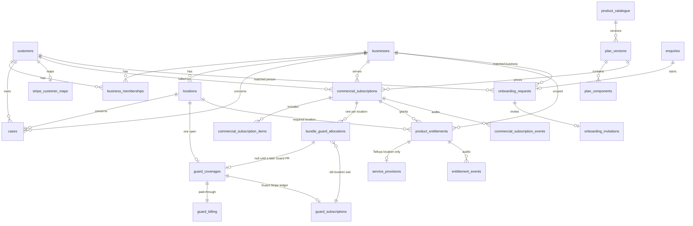
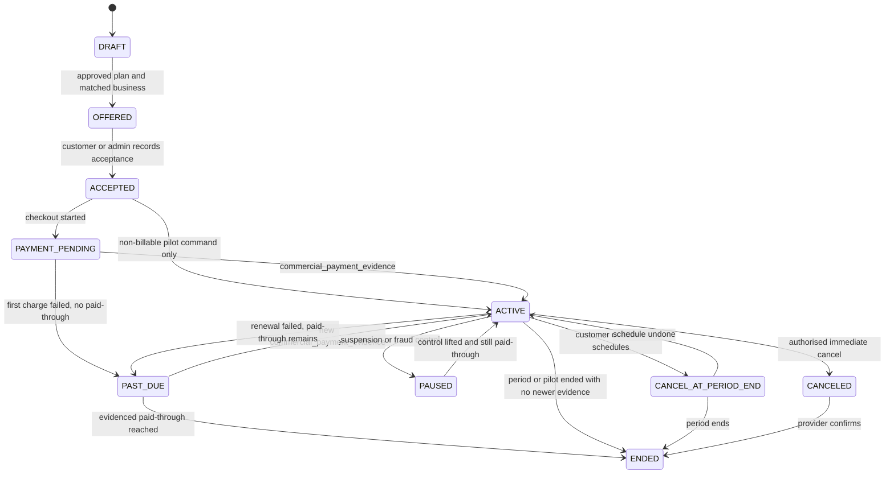

# 02A — Data model

Status: **proposed**, revised against review comments `6559957225` and `6560133090`. Names below are recommended. They are not created by this PR. No prices, Stripe products, or rows are seeded. Complete cannot activate Guard until the gated change in this document exists. Phase 02H does not cancel or credit an existing Guard subscription.

## Recommendation

Add one thin commercial layer for Telloya and Complete. Leave Recovery commerce and Guard billing where they are.

`guard_subscriptions` stays the Guard billing ledger: Stripe subscription id, lifecycle, amount snapshot, and period. `guard_billing` stays the paid-through entitlement that Guard activation already trusts. `guard_coverages` stays the operational coverage record. A new row must not be able to mark a coverage `ACTIVE` or set `guard_billing` to `CURRENT`.

`payment_obligations` stays the Recovery payment ledger. A Recovery case does not become a commercial subscription.

Telloya has no ledger today, so Telloya standalone and the Complete bundle get the new commercial subscription. Complete's Guard benefit is a seat and a reconciliation instruction. The money for an existing Guard location still moves only through the existing Guard cancellation, credit, and invoice functions. There is one Stripe customer per ProfileRelaunch customer (`stripe_customer_maps`). There must not be a second Stripe customer, and a Guard `stripe_subscription_id` must not be copied onto the commercial subscription.

## Catalogue

### `public.product_catalogue`

Sellable commercial products only.

| Column | Rule |
| --- | --- |
| `code` | Primary key. Allowed: `TELLOYA`, `COMPLETE`. |
| `name` | Not blank. |
| `kind` | `STANDALONE` or `BUNDLE`. Telloya is standalone. Complete is a bundle. |
| `status` | `DRAFT`, `APPROVED`, `RETIRED`. |
| `record_version`, timestamps | Same pattern as `customers`. |

Recovery and Guard are not rows here. They already have service codes. Putting them in this table would create a second catalogue beside `price_versions`.

### `public.plan_versions`

| Column | Rule |
| --- | --- |
| `id` | UUID primary key. |
| `product_code` | Foreign key to `product_catalogue`. |
| `version_number` | Integer, unique with `product_code`. |
| `status` | `DRAFT`, `APPROVED`, `RETIRED`. |
| `effective_from`, `effective_to` | `effective_to` null means open. Approved windows for one product must not overlap. Follow the `price_versions` predecessor rule. |
| `billing_cadence` | `MONTH`, `YEAR`, `ONCE`. A non-billable pilot is a grant on the subscription, not a catalogue cadence. |
| `currency` | `char(3)`, default `GBP`. |
| `amount_minor` | Integer pence, **null until a human approves a verified price**. A null amount cannot be offered as billable. |
| `tax_behaviour` | Null until a human records it. A billable offer is refused while it is null. |
| `terms_ref` | Text, the approved terms identity. Not a URL pasted from the browser. |
| `approved_by`, `approved_at` | Required when status is `APPROVED`. |

No seed prices in the first migration. `lib/pricing.ts` is not a source for Telloya or Complete.

### `public.plan_components`

| Column | Rule |
| --- | --- |
| `plan_version_id` | Foreign key, `ON DELETE RESTRICT`. |
| `component_code` | `TELLOYA` or `GUARD`. |
| `quantity_limit` | Integer > 0. |
| `scope` | `BUSINESS` or `LOCATION`. |
| Primary key | `(plan_version_id, component_code)`. |

Both components are `LOCATION` scope. Telloya is billed once per business and operated once per location: the plan's `quantity_limit` is how many locations that one subscription may include. A Complete plan has `TELLOYA` and `GUARD`, each with its own location cap. The caps are data on the approved plan version, not a constant in the portal. A business-scoped component is not used. PostgreSQL would treat two `NULL` location ids as distinct, so the model does not rely on a nullable location in a unique key.

Guard component rows do not contain a Stripe price. The Guard price remains `price_versions` plus `guard_provider_price_maps` for standalone Guard only.

## Commercial subscription

### `public.commercial_subscriptions`

Used for Telloya standalone and Complete. Not used for a Recovery case. Not a copy of `guard_subscriptions`, and it has no single column pointing at one Guard subscription. One occupying row per business. The same customer may occupy a second row only on a different `business_id`. An incoming replacement may sit beside the occupying row.

| Column | Rule |
| --- | --- |
| `id` | UUID primary key. |
| `public_ref` | Unique, human reference. Do not reuse `PR-` / `RV-` case refs. |
| `customer_id` | Billing customer. Foreign key, `ON DELETE RESTRICT`. |
| `business_id` | The business served. Foreign key, `ON DELETE RESTRICT`. |
| `plan_family` | `VOICE`. Both `TELLOYA` and `COMPLETE` use this family so they cannot both occupy one business. |
| `plan_version_id` | Foreign key to an `APPROVED` plan at acceptance. Pinned. |
| `grant_kind` | `BILLABLE` or `NON_BILLABLE_PILOT`. |
| `state` | See transitions below. |
| `amount_minor` | Immutable snapshot. Null only when `grant_kind = NON_BILLABLE_PILOT`. Required and greater than 0 when `BILLABLE`. |
| `currency` | Immutable `char(3)`. Required. Pilots still record `GBP` and a null amount. |
| `tax_behaviour` | Immutable. Null until known. A billable offer is refused while it is null. |
| `tax_amount_minor` | Immutable integer, null only when tax does not apply. |
| `cadence_snapshot` | Immutable copy of the plan cadence. |
| `terms_ref` | Immutable copy of the plan's terms identity. |
| `quantity_limit_snapshot` | Immutable per component, stored on the items. |
| `stripe_customer_id` | Null until a later payment phase. If set, it must equal `stripe_customer_maps.stripe_customer_id` for `customer_id`. |
| `stripe_subscription_id` | Null until that phase. Unique when set. Reject any value that already exists on `guard_subscriptions.stripe_subscription_id`. |
| `current_period_start`, `current_period_end` | Null until a paid period or a pilot window exists. |
| `pilot_ends_at` | Required for `NON_BILLABLE_PILOT`. Must be null for `BILLABLE`. |
| `cancel_at_period_end` | Boolean, default false. |
| `canceled_at`, `ended_at` | Set only on those transitions. |
| `succeeds_subscription_id` | Nullable self foreign key. Set when this row is the incoming replacement for another row of the same business. The old row is not deleted. |
| `record_version`, timestamps | Standard. |

There is no `reconciled_guard_subscription_id` on this table. Several Guard locations cannot share one column.

Snapshot columns are copied from the approved plan at acceptance and a trigger rejects later updates. A price change is a new acceptance, written as a subscription event, not an in-place edit.

Occupancy is per business, not per customer:

| Index | Rows it allows |
| --- | --- |
| Unique `(business_id)` where `state IN ('ACTIVE','PAUSED','PAST_DUE','CANCEL_AT_PERIOD_END')` | One occupying subscription. A second business owned by the same customer is a different `business_id`. |
| Unique `(business_id)` where `state IN ('OFFERED','ACCEPTED','PAYMENT_PENDING')` | One incoming subscription, so a replacement can be offered while the occupying row is still in force. |

`PAST_DUE` occupies the business. It removes access only when no paid period is still open. A first charge that never produced `commercial_payment_evidence` leaves entitlements `PENDING`. A renewal failure after evidence leaves entitlements `ELIGIBLE` until `current_period_end`, which is that evidence's `period_end`. Expiry is that timestamp passing with no newer evidence. It is not the renewal failure itself. `ACTIVE` entitles only under the grant rules below. `DRAFT`, `CANCELED`, and `ENDED` do not occupy.

Suspension and fraud are different from `PAST_DUE`. `PAUSED`, or an entitlement `REVOKED` for fraud, may stop access before paid-through. Both require `admin_session_v1`, a reason, and an event. A provider webhook must not use that path, and it must not shorten `current_period_end` or an existing `guard_billing.paid_through_at`.

If an occupying row exists, the incoming row's `succeeds_subscription_id` must point at it. The switch command, in one transaction, sets the old entitlement `eligible_to` and the new entitlement `eligible_from` to the same timestamp. There is no interval where the business has neither an eligible row nor an explicit expired row. A period-end switch leaves the old entitlement eligible until `current_period_end` and the new one `PENDING` until that instant.

The billing customer must have a verified membership before the state can leave `DRAFT`. Revoking that membership later hides the business for that person and does not delete the subscription.

### `public.commercial_subscription_items`

| Column | Rule |
| --- | --- |
| `subscription_id`, `component_code` | Primary key. Component must exist on the pinned plan version. |
| `quantity` | Integer, 1..`quantity_limit`. This is the location cap, not a phone number shared across locations. |
| `quantity_limit_snapshot` | Immutable copy of the plan cap at acceptance. |
| `stripe_subscription_item_id` | Null until the payment phase. |

### `public.commercial_payment_evidence`

A billable subscription becomes `ACTIVE` only from a row here. An admin sentence is not evidence. `public.payment_receipts` is not evidence either: that table requires a Recovery `payment_obligations` row (`obligation_id` is `NOT NULL` and unique). A Telloya or Complete period is not a Recovery obligation, so this table does not reference `payment_receipts`.

| Column | Rule |
| --- | --- |
| `id` | UUID primary key. |
| `subscription_id` | Foreign key. The subscription `grant_kind` must be `BILLABLE`. |
| `period_start`, `period_end` | The period this evidence pays. Copied onto the subscription as `current_period_start` and `current_period_end`. |
| `amount_minor`, `currency` | Must equal the subscription snapshots. A mismatch is refused. |
| `provider_event_id` | Required for the Stripe path. It must already exist in `admin_private.stripe_event_receipts` for a processed paid-invoice event, and it must not already have been applied to Guard. |
| Unique | `provider_event_id`, and `(subscription_id, period_end)`. The same invoice cannot pay two periods or two subscriptions. |

`checkout.session.completed` and a Stripe subscription status of `active` do not qualify as the paid-invoice event.

A non-Stripe payment rail is **pending**. If one is approved later it needs its own append-only commercial receipt, with actor, external evidence reference, and the same amount, currency, tax, and period snapshots. It is not a flag on `commercial_subscriptions`, and it is not a row in `payment_receipts`. 02B does not create that rail. 02F does not invent one.

`NON_BILLABLE_PILOT` must not have a row in this table. Its only authority is the pilot command: actor from `admin_session_v1`, reason, and `pilot_ends_at`. The portal calls that a pilot, never paid.

### State transitions

`ACTIVE` means the commercial term is in force. For `BILLABLE` that requires `commercial_payment_evidence` whose period contains `now()`. For `NON_BILLABLE_PILOT` it requires the pilot command and `pilot_ends_at` still in the future. A billable row may also sit in `PAST_DUE` while `current_period_end` is still in the future: the customer keeps the period they already paid, and the portal says the renewal failed. Access ends at that `current_period_end` if no newer evidence arrives. `ACTIVE` does not mean Telloya is answering calls or that Guard monitoring is on.

Checkout success, `checkout.session.completed`, a Stripe subscription status of `active`, and an admin marking a billable row paid are not evidence. There is no manual-paid state.

## Entitlement

### `public.product_entitlements`

This is who may use a component. It is not a payment and not an operational switch.

| Column | Rule |
| --- | --- |
| `id` | UUID primary key. |
| `business_id` | Required. Foreign key. |
| `location_id` | Not null. Both Telloya and Guard are per location. |
| `component_code` | `TELLOYA` or `GUARD`. |
| `source_kind` | `COMMERCIAL_SUBSCRIPTION`, `GUARD_COVERAGE`, or `NON_BILLABLE_PILOT`. |
| `commercial_subscription_id` | Set unless `source_kind = GUARD_COVERAGE`. |
| `guard_coverage_id` | Null for Telloya. For Guard, null until a later gated Guard migration has created a legal coverage. A non-null value must be a coverage for this same location and business. |
| `state` | `PENDING`, `ELIGIBLE`, `REVOKED`, `EXPIRED`. |
| `eligible_from`, `eligible_to` | `eligible_to` is the evidenced `period_end`, the pilot end, or the scheduled cancel time. A renewal failure does not clear it. |
| `revoked_at`, `revoked_by`, `revocation_reason` | Required together when `REVOKED`. |
| Location consistency | Composite foreign key `(location_id, business_id)` → `locations (id, business_id)`. Add `UNIQUE (id, business_id)` on `locations` to support it. The location primary key alone does not prove the business. |
| Checks | A `GUARD` entitlement cannot update `guard_coverages` or `guard_billing`. |

Unique index, `NULLS NOT DISTINCT` is unnecessary because `location_id` is not null:

`UNIQUE (business_id, location_id, component_code) WHERE state IN ('PENDING','ELIGIBLE')`.

Two businesses for one customer are two `business_id` values, so this index does not collapse them. Two locations of one business are two `location_id` values.

Access for a person is: valid portal session, `business_memberships` verified for that business, and an `ELIGIBLE` entitlement whose window contains `now()`. Revoking the membership hides the product immediately. The entitlement row remains for the business until it is revoked or it expires. Commercial history is not deleted.

Recovery does not get an entitlement row. Case access stays `cases.customer_id` plus the existing portal case RPCs. A later decision can widen that. This model does not.

### Why a Guard entitlement is not coverage

A `GUARD` entitlement means the commercial term includes that location. It does not create `guard_coverages` and it does not satisfy `guard_coverage_readiness_v1`. Today's readiness still requires a legal origin, and none of `DIRECT_GUARD`, `INCLUDED_RECOVERY`, or `INCLUDED_CONTINUATION` can describe a Complete-funded location. See the bridge below. Until the gated Guard change exists, `guard_coverage_id` stays null and the portal must not say Guard can be activated.

## Complete to Guard bridge

### What 02B is allowed to store

`public.bundle_guard_allocations` is the only Complete-to-Guard link in the first schema. It is not a coverage, not an invoice, and not a call to `guard_set_billing_entitlement_v1`.

| Column | Rule |
| --- | --- |
| `id` | UUID primary key. |
| `subscription_id` | Foreign key. The plan must include a `GUARD` component. |
| `subscription_item` | The Guard item on that subscription. |
| `customer_id`, `business_id`, `location_id` | Must match each other. Composite foreign key `(location_id, business_id)` → `locations (id, business_id)`. |
| `state` | In 02B: `RESERVED`, `PREVIEW`, `LAPSED`, `ENDED`. Later, and only after 02I: `CUTOVER_SCHEDULED` and `FUNDED`. There is no `RECONCILING`, `READY_FOR_GUARD_SCHEMA`, or `LINKED` state. 02B cannot insert a legal coverage. |
| `paid_through_at` | Planned Complete period end for this seat. Null while no Complete period is evidenced. It is not written into `guard_billing` by 02B or 02H. |
| `scheduled_cutover_at` | Null in 02H. Set only after 02I, to this location's current `guard_billing.paid_through_at` for a boundary cutover, or to an earlier instant that 02J will credit inside the same transaction. |
| `effective_from`, `effective_to` | The allocation window. |
| `standalone_guard_subscription_id` | Nullable foreign key to the open `guard_subscriptions` row for this location. Setting it does not end that row. |
| `guard_coverage_id` | Null while the state is `RESERVED`, `PREVIEW`, `CUTOVER_SCHEDULED`, `LAPSED`, or `ENDED` before funding. After a successful 02J cutover it stores the coverage that already existed, or the one coverage 02I created for a location that had none. 02B's check forces null. |
| `request_id` | The idempotency key of the command that created or last changed the row. |

Indexes:

- Unique `(location_id)` where `state IN ('RESERVED','PREVIEW')` in 02B, extended by 02J to include `CUTOVER_SCHEDULED` and `FUNDED`. One location cannot be in two open bundle allocations. 02B's state check does not allow those later values.
- Unique `(subscription_id, location_id)`.
- A count of open allocations for a subscription must be less than or equal to that item's `quantity_limit_snapshot`. Enforce it in the command with a row lock on the subscription, and add a deferred constraint trigger so two concurrent commands cannot both pass.

`bundle_guard_allocation_events` is append-only: allocation id, actor, `request_id`, from state, to state, reason, and the standalone Guard subscription id when relevant. Repeating the same `request_id` returns the stored result. A refused cancel or credit is still an event. It is not a silent no-op.

`RESERVED` means the seat is held and this location has no open Guard subscription. `PREVIEW` means an open standalone Guard subscription was recorded and left untouched. `CUTOVER_SCHEDULED` means 02I is present, a verified Complete period exists, and `scheduled_cutover_at` is set, but Guard rows are still unchanged. `FUNDED` means the 02J transaction committed. `LAPSED` means the Complete period ended. `ENDED` means the seat was removed. Ending a `PREVIEW` seat does not end the standalone subscription.

02H may insert `RESERVED` or `PREVIEW` only. It must not call Guard cancel, Guard credit, `guard_activate_v1`, or `guard_apply_invoice_paid_v1`. It must not change `guard_subscriptions`, `guard_coverages`, or `guard_billing`.

### Cutover after 02I

02J is the only phase that may end or credit a standalone Guard subscription for a Complete upgrade. It cannot run until 02I has added the bundle origin, `entitlement_source = BUNDLE`, the readiness branch, and `guard_apply_bundle_paid_through_v1`, and until this location has a verified Complete period with `period_end > now()`.

`admin_private.guard_cutover_bundle_location_v1` is idempotent on `(allocation_id, scheduled_cutover_at)`. It takes `admin_session_v1` and `p_request`. One location per call. Dock being ready does not include Yard.

| Mode | When | What the one transaction does |
| --- | --- | --- |
| Boundary, the default | `scheduled_cutover_at` equals this location's `guard_billing.paid_through_at`. The command refuses to run earlier. | Ends that standalone subscription at the boundary, so no prepaid remainder remains. Applies bundle paid-through from that same timestamp through the Complete `period_end`. Keeps the existing coverage row. Does not insert a second coverage, a second open subscription, or a second invoice for the overlapping days. |
| Credited remainder | An admin explicitly chooses an earlier `scheduled_cutover_at`. | Credits the unused Guard remainder and applies bundle funding from that instant. If either step fails, both roll back. Coverage never sits with neither `PROVIDER` nor `BUNDLE` current. |

While a location is `PREVIEW`, its only Guard charge is the existing Guard subscription. Complete `commercial_payment_evidence` is refused when the evidence period overlaps that location's `guard_billing.paid_through_at`. Locations do not share a cutover clock. If the bundle price cannot exclude a location that is still inside its standalone paid-through, the charge writer refuses the Complete charge and leaves every `PREVIEW` location on standalone Guard. It does not cancel a location to make the charge fit.

A failed 02J attempt writes the event and leaves every Guard row as it was. The same `request_id` returns that stored result. A committed cutover is not reversed by deleting coverage. Compensation is a later forward command. It may run only when it can restore one current source, `PROVIDER` or `BUNDLE`, without a gap. If it cannot, it records an issue and stops.

### Later gated Guard change

A separate PR, after 02B and not part of it, may add:

- `coverage_origin = BUNDLE_COMPLETE` and a new `coverage_basis` that is neither `DIRECT_GUARD` nor `INCLUDED`, so `guard_coverages_included_period` does not force 30 days and `guard_coverages_basis_origin` does not demand a recovery case or a `RELAUNCH_GUARD` service order. For a location that already has a coverage, 02J keeps that row and changes its funding. It does not insert a second non-ended coverage.
- `guard_billing.entitlement_source = BUNDLE`, allowed to be `CURRENT` only while `paid_through_at > now()` and that timestamp equals the funded allocation's `paid_through_at`. A failed Complete renewal must not shorten a `paid_through_at` that is still in the future. Guard's own rule already says this for provider renewals: `invoice.payment_failed` does not remove service while `paid_through_at > now()`.
- A new private writer, `admin_private.guard_apply_bundle_paid_through_v1`, which reads the allocation and the commercial period. It is idempotent on `(allocation_id, period_end)`. It refuses to move `paid_through_at` backwards. It is not `guard_set_billing_entitlement_v1`, and that function stays ungranted to `service_role`. 02I ships the writer. 02I does not call it against a location whose standalone subscription is still open. 02J is the caller for that location.
- A readiness branch only for the new origin: billing is ready when the bundle source is current. Membership, permission, access, contact, baseline, rota, and mapping stay mandatory. `guard_activate_v1` remains the only way to set `ACTIVE`. An existing `ACTIVE` coverage stays `ACTIVE` across the cutover. 02J does not deactivate it in order to fund it.

Tests, before any Complete customer is told their Guard seat has moved:

| Case | Expected |
| --- | --- |
| 02H preview | Dock and Yard gain `PREVIEW` rows. Their `guard_subscriptions` lifecycle, `guard_coverages.state`, and `guard_billing.paid_through_at` are unchanged. Cancel and credit are not called. |
| One location not ready | Dock may become `CUTOVER_SCHEDULED` after 02I. Yard stays `PREVIEW`. Yard's coverage stays in force and its paid-through is unchanged. The portal still shows Yard as existing Guard, not as bundle Guard. |
| 02J before 02I | Rejected. No Guard row changes. |
| Boundary cutover | One coverage row before and after. The standalone subscription ends at its paid-through. Bundle paid-through starts at that same timestamp. No second charge for the overlapping days. |
| Credited remainder | The credit and the bundle apply commit together or not at all. |
| Renewal | A second paid Complete period extends `paid_through_at` once. The same `period_end` does not extend it again. A failed renewal leaves the current `paid_through_at` in place. |
| Lapse | The evidenced period end, with no new evidence, sets the allocation `LAPSED` and moves bundle billing off `CURRENT`. It does not do that when the renewal fails but `paid_through_at` is still in the future. |
| Cancellation | After funding, each open allocation ends through the bundle end path. Coverages are not deleted. No Guard invoice is inserted. A `PREVIEW` cancellation does not end the standalone subscription. |
| Downgrade | A lower quantity is refused while more locations are still open than the new cap. Ending one reservation leaves the others, and does not cancel their standalone Guard subscriptions. |
| Overlap | `PREVIEW` beside an open standalone subscription is allowed. A second open `guard_subscriptions` row is still refused. `FUNDED` plus an open standalone subscription on the same location is refused. |
| Privilege | `service_role` still cannot execute `guard_set_billing_entitlement_v1`. |

Until 02I is applied, documents and the portal must not say a Complete customer can activate Guard. Until 02J commits for that location, documents and the portal must not say the standalone Guard subscription has been replaced.

## Telloya provisioning

### `public.service_provisions`

One row per Telloya entitlement, and therefore one per location. A business with two locations has two provisions. They do not share an agent or a phone number.

| Column | Rule |
| --- | --- |
| `entitlement_id` | Unique foreign key. |
| `business_id`, `location_id` | Must match the entitlement. Composite foreign key to `locations (id, business_id)`. |
| `state` | `NOT_STARTED`, `PROFILE_REQUIRED`, `AGENT_REQUIRED`, `NUMBER_REQUIRED`, `FORWARDING_REQUIRED`, `TEST_REQUIRED`, `AWAITING_CONFIRMATION`, `READY_FOR_PROVIDER_VERIFICATION`, `LIVE`, `SUSPENDED`, `ENDED`. |
| `profile_ready_at` | This location's profile accepted by an admin command. |
| `agent_configured_at` | This location's agent recorded by an admin command. That timestamp is not provider proof. |
| `number_allocated_at` | A number was requested for this location. The browser does not choose it. The timestamp is not proof that a provider issued it. |
| `provider_binding_ref` | Nullable until verification. Unique when set. Server-side only. Two locations must not store the same ref. Required before `LIVE`. |
| `forwarding_instructed_at` | Forwarding instructions recorded for this location. |
| `provider_test_call_ref` | Nullable until verification. Unique when set. The provider's call id, stored by the provider command. Required before `LIVE`. |
| `provider_test_outcome` | Null, `PASSED`, or `FAILED`. `LIVE` requires `PASSED`. An admin form cannot set this. |
| `agent_test_passed_at` | Set only by the provider command that stores a unique call id and `PASSED`. An admin timestamp write cannot set it. |
| `customer_confirmed_at` | The verified member confirmed this location. Confirmation without provider evidence stops at `READY_FOR_PROVIDER_VERIFICATION`. |
| `live_at` | Set only by the provider command that moves this location to `LIVE`. |
| `suspended_at`, `suspension_reason` | Set together when `SUSPENDED`. |

A check rejects `state = LIVE` unless `provider_binding_ref`, `provider_test_call_ref`, `provider_test_outcome = PASSED`, `live_at`, `customer_confirmed_at`, and the setup timestamps are all present.

Unique `(location_id)` where `state NOT IN ('SUSPENDED','ENDED')` keeps one active binding per location.

02E may move a location as far as `READY_FOR_PROVIDER_VERIFICATION`. It must reject `LIVE`. The later provider command is the only writer of the binding ref, the test-call ref, the outcome, and `LIVE`. Each location is verified on its own. A manually typed timestamp, with or without a second admin looking at it, is not that command. A future DEV pilot that wants a human to record provider proof is not part of 02E. It would still need the real binding ref, the real call id, `PASSED`, and a second admin signoff, and it is not approved here.

`LIVE` also requires an `ELIGIBLE` entitlement and a commercial term that is still inside its paid-through or pilot end. A second location of the same business can remain `READY_FOR_PROVIDER_VERIFICATION`. The product is not Active for the business while any entitled location is not `LIVE`.

No provider credential or call recording is stored. The browser never receives a provider secret.

## Onboarding

### `public.onboarding_requests`

| Column | Rule |
| --- | --- |
| `id` | UUID primary key. |
| `enquiry_id` | Nullable foreign key. Does not change `enquiries.status` and does not set `case_id`. |
| `customer_id`, `business_id` | Null until an admin matches them. |
| `email_snapshot` | Lower-case email. It is not a uniqueness key by itself. |
| `product_code` | `TELLOYA` or `COMPLETE`. Guard-only and Recovery stay on their current enquiry conversion. |
| `plan_family` | `VOICE`, so Telloya and Complete compete per business, not per email. |
| `state` | `RECEIVED`, `IN_REVIEW`, `MAILBOX_REQUIRED`, `OFFERED`, `INVITED`, `AWAITING_PAYMENT`, `PROVISIONING`, `READY`, `CLOSED`, `DECLINED`. |
| `decline_reason` | Required when `DECLINED`. |
| `commercial_subscription_id` | Null until an offer becomes a subscription. |

Deduplication is business-scoped and enquiry-scoped. It is not `(email_snapshot, product_code)`, which would block one person from opening a second business.

| Index | Purpose |
| --- | --- |
| Unique `enquiry_id` where `enquiry_id` is not null and state is not `CLOSED` or `DECLINED` | One open request per enquiry. A second admin insert returns the existing row. |
| Unique `(business_id, plan_family)` where `business_id` is not null and state is not `CLOSED` or `DECLINED` | One open Voice request per business after the business is matched. |

An unmatched enquiry has a null `business_id`, so the second index does not apply. The same email may have two unmatched enquiries for two future businesses. After match, the business index applies. A customer with two matched businesses has two requests.

### `admin_private.onboarding_invitations`

| Column | Rule |
| --- | --- |
| `token_hash` | Primary key. SHA-256 of the secret. The raw token is not stored. |
| `onboarding_request_id` | Foreign key. |
| `email_snapshot` | Must match the request. |
| `expires_at` | Required. Recommended default 7 days. |
| `customer_id` | The unmatched address is not invited. The customer row may exist with no contact verification. |
| `consumed_at` | Null until OTP finish consumes it in the same transaction as the session. |
| `send_count` | Incremented only when a queued email is accepted. |
| `mailbox_proved_at` | Null until OTP finish. Admin approval does not set it. |

Partial unique index: one unconsumed invitation per onboarding request.

Admin approval must not call `admin_contact_verify_v1` for a mailbox nobody has proved. That function only stores an administrator evidence string of 10 to 1000 characters and a non-null `verified_by`. `verified_current_email_v1` reads `customer_contact_verifications` and returns null when that row is missing. `customer_portal_begin_login_v1` then returns `ineligible`.

The existing OTP functions cannot be called unchanged for that customer. `customer_portal_begin_login_v1`, `customer_portal_confirm_otp_sent_v1`, `customer_portal_begin_resend_v1`, `customer_portal_attempt_otp_v1`, and `customer_portal_finish_otp_v1` all consult `verified_current_email_v1` through `customer_portal_email_current_v1`. Each one rejects an unverified address. `customer_portal_session_v1` also returns null until the verification row exists.

The invited path reuses the Supabase OTP, `customer_portal_reserve_send_v1`, `customer_portal_login_challenges`, `customer_portal_auth_identity_current_v1`, and `customer_portal_sessions`. It does not add a second session table or a second rate limit. It is not a call to the five functions above.

1. `customer_portal_begin_invited_login_v1(p_invitation_hash, p_pending_hash)` loads one unconsumed, unexpired invitation whose email still equals `customers.email`. It inserts the same challenge row `begin_login` would insert, with `expected_email_snapshot` set to that email, and it consumes the same send reservation. An unknown hash, an expired hash, a consumed hash, and an invitation whose email no longer matches all return the same generic `unavailable` result. If the email is already verified, it returns `unavailable` as well, so this function cannot be used to bypass `begin_login`.
2. Invited confirm, resend, and attempt functions mirror the existing ones, including the five-attempt cap, but they authorise the challenge from the open invitation instead of from `customer_portal_email_current_v1`. They refuse a challenge that `begin_login` created.
3. After `verifyOtp` succeeds, `customer_portal_finish_invited_otp_v1(p_pending_hash, p_session_hash, p_auth_user, p_email, p_invitation_hash)` checks `customer_portal_auth_identity_current_v1`. It then inserts the email verification, consumes the challenge and the invitation, and inserts a normal `customer_portal_sessions` row with the same lifetime columns `finish_otp` uses. The verification insert happens before the session insert. `customer_portal_session_v1` would otherwise see no verified email and return null.

`customer_contact_verifications` has no `proof_kind` today, and `verified_by` is `NOT NULL`. The invited finish therefore needs a later migration, not a write that pretends the current row shape is enough:

- Add `proof_kind` with values `ADMIN_RECORDED` and `MAILBOX_OTP`. Existing rows default to `ADMIN_RECORDED`.
- Allow `verified_by` to be null only when `proof_kind = MAILBOX_OTP`. `ADMIN_RECORDED` still requires `verified_by`.
- `admin_contact_verify_v1` keeps writing `ADMIN_RECORDED` and the admin user id. It is not mailbox proof.
- `MAILBOX_OTP` evidence is the challenge hash, not the one-time code. A SHA-256 hex string fits the existing 10 to 1000 character evidence check.

The next sign-in uses ordinary `customer_portal_begin_login_v1`. The invited functions keep refusing an address that already has an email verification.

`admin_membership_save_v1` still refuses `verified` until some contact is verified. Business authority stays a separate decision, made only after mailbox proof exists. Membership evidence is not a substitute for the OTP.

An invitation hash never inserts a session by itself.

## Audit

Append-only, same posture as `guard_coverage_events` and `admin_audit_events`.

| Table | Written when |
| --- | --- |
| `public.commercial_subscription_events` | Every subscription state change. Columns: `subscription_id`, `actor_id` null for a webhook, `request_id`, `from_state`, `to_state`, `reason`, `created_at`. No update, no delete. |
| `public.entitlement_events` | Every entitlement state change, same shape. |
| `admin_private.commercial_command_receipts` | Primary key `request_id`. Also `actor_id`, `fingerprint`, `response`, `created_at`. |

Admin RPCs take `p_request uuid` and the admin session token. The actor is the session, as in `admin_guard_command_v1`. A repeated fingerprint returns the stored response and does not apply twice.

Webhook application, when it exists later, inserts `stripe_event_receipts` first and no-ops on conflict. It does not get a new receipt table.

## Ownership and deletion

Every new public table is `ON DELETE RESTRICT` to customers, businesses, locations, subscriptions, and coverages. Ending a product sets states and timestamps. It does not delete the row. Revocation is a state.

`service_role` executes the reviewed RPCs only. Table privileges for `anon`, `authenticated`, and `service_role` are revoked, matching Guard and portal tables. RLS is enabled and no browser policy is added.

## What is deliberately absent

- A second `customers` or `businesses` table.
- A Telloya login or Telloya user id.
- A `guard_coverages` origin for Complete. That is a later gated PR, not 02B.
- A call to `guard_set_billing_entitlement_v1` from the application.
- A 02H command that cancels, credits, or shortens an existing Guard subscription or coverage.
- `LIVE` from admin-entered timestamps without a provider binding and a passed test call.
- A renewal failure that shortens `current_period_end` or `guard_billing.paid_through_at`.
- A generic entitlement that Guard activation reads instead of `guard_billing`.
- An admin command that marks a billable subscription paid without `commercial_payment_evidence`.
- A foreign key from that evidence to `payment_receipts`. Those receipts belong to Recovery obligations.
- Stripe product or price ids.
- Seeded amounts.
- A Complete dashboard route.
- Changes to `apps/customer/lib/portal/products/*`.
