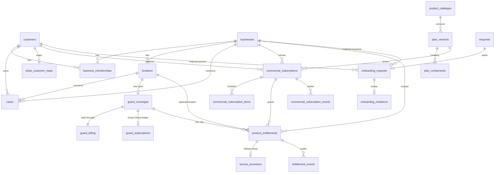
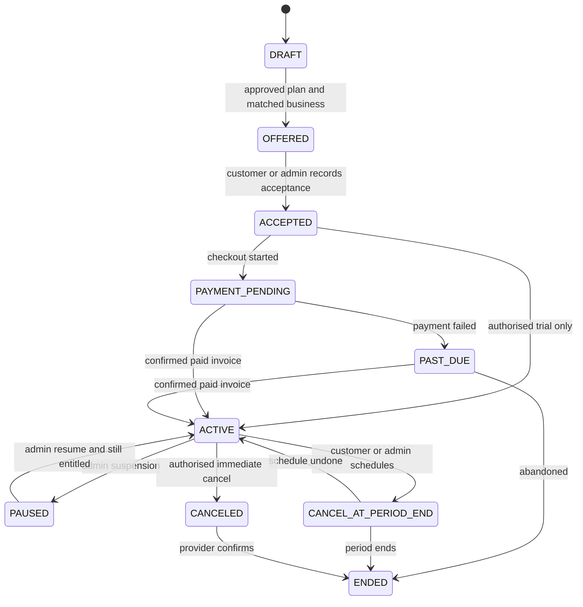

# 02A — Data model

Status: **proposed**. Names below are recommended. They are not created by this PR. No prices, Stripe products, or rows are seeded.

## Recommendation

Add one thin commercial layer for Telloya and Complete. Leave Recovery commerce and Guard billing where they are.

`guard_subscriptions` stays the Guard billing ledger: Stripe subscription id, lifecycle, amount snapshot, and period. `guard_billing` stays the paid-through entitlement that Guard activation already trusts. `guard_coverages` stays the operational coverage record. A new row must not be able to mark a coverage `ACTIVE` or set `guard_billing` to `CURRENT`.

`payment_obligations` stays the Recovery payment ledger. A Recovery case does not become a commercial subscription.

Telloya has no ledger today, so Telloya standalone and the Complete bundle get the new commercial subscription. Complete's Guard benefit is a seat and a reconciliation instruction. The money for an existing Guard location still moves only through the existing Guard cancellation, credit, and invoice functions. There is one Stripe customer per ProfileRelaunch customer (`stripe_customer_maps`). There must not be a second Stripe customer, and a Guard `stripe_subscription_id` must not be copied onto the commercial subscription.

## Catalogue

### `public.product_catalogue`

Sellable commercial products only.

| Column | Rule |
| --- | --- |
| `code` | Primary key. Allowed: `TELLOYA`, `COMPLETE`. |
| `name` | Not blank. |
| `kind` | `STANDALONE` or `BUNDLE`. Telloya is standalone. Complete is a bundle. |
| `status` | `DRAFT`, `APPROVED`, `RETIRED`. |
| `record_version`, timestamps | Same pattern as `customers`. |

Recovery and Guard are not rows here. They already have service codes. Putting them in this table would create a second catalogue beside `price_versions`.

### `public.plan_versions`

| Column | Rule |
| --- | --- |
| `id` | UUID primary key. |
| `product_code` | Foreign key to `product_catalogue`. |
| `version_number` | Integer, unique with `product_code`. |
| `status` | `DRAFT`, `APPROVED`, `RETIRED`. |
| `effective_from`, `effective_to` | `effective_to` null means open. Approved windows for one product must not overlap. Follow the `price_versions` predecessor rule. |
| `billing_cadence` | `MONTH`, `YEAR`, `ONCE`, `TRIAL`. |
| `currency` | `char(3)`, default `GBP`. |
| `amount_minor` | Integer pence, **null until a human approves a verified price**. A null amount cannot be offered or charged. |
| `trial_days` | Integer null. Required only when cadence is `TRIAL`, and then greater than 0. |
| `terms_ref` | Text, the approved terms identity. Not a URL pasted from the browser. |
| `approved_by`, `approved_at` | Required when status is `APPROVED`. |

No seed prices in the first migration. `lib/pricing.ts` is not a source for Telloya or Complete.

### `public.plan_components`

| Column | Rule |
| --- | --- |
| `plan_version_id` | Foreign key, `ON DELETE RESTRICT`. |
| `component_code` | `TELLOYA` or `GUARD`. |
| `quantity_limit` | Integer > 0. |
| `scope` | `BUSINESS` or `LOCATION`. |
| Primary key | `(plan_version_id, component_code)`. |

A Telloya plan has one `TELLOYA` / `BUSINESS` component. A Complete plan has `TELLOYA` / `BUSINESS` and `GUARD` / `LOCATION` with the agreed location limit. The limit is data on the approved plan version, not a constant in the portal.

Guard component rows do not contain a Stripe price. The Guard price remains `price_versions` plus `guard_provider_price_maps` for standalone Guard only.

## Commercial subscription

### `public.commercial_subscriptions`

Used for Telloya standalone and Complete. Not used for a Recovery case. Not used as a copy of `guard_subscriptions`.

| Column | Rule |
| --- | --- |
| `id` | UUID primary key. |
| `public_ref` | Unique, human reference. Do not reuse `PR-` / `RV-` case refs. |
| `customer_id` | Billing customer. Foreign key, `ON DELETE RESTRICT`. |
| `business_id` | The business served. Foreign key, `ON DELETE RESTRICT`. |
| `plan_version_id` | Foreign key to an `APPROVED` plan at acceptance time. Pinned. Later catalogue edits do not rewrite it. |
| `state` | See transitions below. |
| `stripe_customer_id` | Null until a later payment phase. If set, it must equal `stripe_customer_maps.stripe_customer_id` for `customer_id`. |
| `stripe_subscription_id` | Null until that later phase. Unique when set. A trigger or insert check rejects any value that already exists on `guard_subscriptions.stripe_subscription_id`. |
| `current_period_start`, `current_period_end` | Null until a paid or trial period exists. |
| `trial_ends_at` | Null unless the plan cadence is `TRIAL` or an authorised trial was recorded. |
| `cancel_at_period_end` | Boolean, default false. |
| `canceled_at`, `ended_at` | Set only on those transitions. |
| `replaces_subscription_id` | Nullable self foreign key for an upgrade. The replaced row is ended, not deleted. |
| `reconciled_guard_subscription_id` | Nullable foreign key to `guard_subscriptions`. Set when an existing standalone Guard subscription was matched so it is not charged again. |
| `record_version`, timestamps | Standard. |

Partial unique index: one row per `business_id` whose state is not `CANCELED` or `ENDED`. Telloya and Complete therefore cannot both be open for the same business. That is the double-billing guard.

The billing customer must have a `verified` membership of `business_id` before the state can leave `DRAFT`. Revoking that membership later does not delete the subscription. It removes portal access for that person. Another verified member can still be granted access. Billing history stays.

### `public.commercial_subscription_items`

| Column | Rule |
| --- | --- |
| `subscription_id`, `component_code` | Primary key. Component must exist on the pinned plan version. |
| `quantity` | Integer, 1..`quantity_limit`. |
| `stripe_subscription_item_id` | Null in the first phases. |

### State transitions

`ACTIVE` on this table means the commercial term is in force (paid invoice or an authorised trial that has not expired). It does not mean Telloya is answering calls or Guard monitoring is on.

Checkout success, `checkout.session.completed`, and a Stripe subscription status of `active` do not enter `ACTIVE`. The same rule Guard already uses applies: a confirmed paid invoice, or an explicit admin trial command, is required. The trial command stores the admin actor, reason, and `trial_ends_at`.

## Entitlement

### `public.product_entitlements`

This is who may use a component. It is not a payment and not an operational switch.

| Column | Rule |
| --- | --- |
| `id` | UUID primary key. |
| `business_id` | Required. Foreign key. |
| `location_id` | Null for business scope. Required for location scope. The location must belong to `business_id`. |
| `component_code` | `TELLOYA` or `GUARD`. |
| `source_kind` | `COMMERCIAL_SUBSCRIPTION`, `GUARD_COVERAGE`, `AUTHORISED_TRIAL`. |
| `commercial_subscription_id` | Set for the first and third sources. |
| `guard_coverage_id` | Set when `source_kind = GUARD_COVERAGE`, or when a Complete Guard seat has been linked to a real coverage. |
| `state` | `PENDING`, `ELIGIBLE`, `REVOKED`, `EXPIRED`. |
| `eligible_from`, `eligible_to` | `eligible_to` required for a trial. |
| `revoked_at`, `revoked_by`, `revocation_reason` | Required together when `REVOKED`. |
| Checks | Exactly one source shape. A `GUARD` entitlement cannot set `guard_coverages.state` or `guard_billing.billing_state`. |

Partial unique index: one `PENDING` or `ELIGIBLE` row per `(business_id, location_id, component_code)`.

Access for a person is: valid portal session, `business_memberships` verified for that business, and an `ELIGIBLE` entitlement whose window contains `now()`. Revoking the membership hides the product immediately. The entitlement row remains for the business until it is revoked or it expires. Commercial history is not deleted.

Recovery does not get an entitlement row. Case access stays `cases.customer_id` plus the existing portal case RPCs. A later decision can widen that. This model does not.

### Why Guard entitlement is a link

A Complete or standalone Guard seat can insert a `product_entitlements` row of component `GUARD`. Operational use still requires the existing chain:

1. `guard_location_authorized_v1`
2. permission, access, contact, baseline, rota
3. `guard_billing` `CURRENT` or an included/`NOT_REQUIRED` basis that the coverage origin allows
4. `guard_coverages.state` reaching `ACTIVE` only through `guard_activate_v1`

If the entitlement says `ELIGIBLE` and the coverage is not `ACTIVE`, the portal shows setup in progress, not Active.

Linking `guard_coverage_id` is how Complete avoids a second coverage. The partial unique index on non-ended `guard_coverages.location_id` already prevents two live coverages.

## Telloya provisioning

### `public.service_provisions`

One row per Telloya entitlement.

| Column | Rule |
| --- | --- |
| `entitlement_id` | Unique foreign key. |
| `business_id` | Must match the entitlement. |
| `state` | `NOT_STARTED`, `PROFILE_REQUIRED`, `AGENT_REQUIRED`, `NUMBER_REQUIRED`, `FORWARDING_REQUIRED`, `TEST_REQUIRED`, `AWAITING_CONFIRMATION`, `LIVE`, `SUSPENDED`. |
| `profile_ready_at` | Business profile accepted by an admin command. |
| `agent_configured_at` | Admin recorded that the agent configuration exists. No Retell id in this phase. |
| `number_allocated_at` | Admin recorded allocation. The provider number is not selected by the browser. |
| `forwarding_instructed_at` | Customer has been given forwarding instructions. |
| `agent_test_passed_at` | A successful test was recorded by an admin command. |
| `customer_confirmed_at` | The verified customer confirmed activation. |
| `live_at` | Set only by the command that moves state to `LIVE`. |
| `suspended_at`, `suspension_reason` | Set together when `SUSPENDED`. |

`LIVE` is allowed only when all six timestamps are set, the entitlement is `ELIGIBLE`, and the commercial subscription is `ACTIVE` or a trial window is current. Payment alone leaves the provision below `LIVE`.

No phone-number table and no Retell credential table in the first schema. Those wait until a provider phase, and credentials stay server-side.

## Onboarding

### `public.onboarding_requests`

| Column | Rule |
| --- | --- |
| `id` | UUID primary key. |
| `enquiry_id` | Nullable foreign key. Does not change `enquiries.status` and does not set `case_id`. |
| `customer_id`, `business_id` | Null until an admin matches them. |
| `email_snapshot` | Lower-case email from the enquiry or the matched customer. |
| `product_code` | `TELLOYA` or `COMPLETE`. Guard-only and Recovery stay on their current enquiry conversion. |
| `state` | `RECEIVED`, `IN_REVIEW`, `IDENTITY_REQUIRED`, `OFFERED`, `INVITED`, `AWAITING_PAYMENT`, `PROVISIONING`, `READY`, `CLOSED`, `DECLINED`. |
| `decline_reason` | Required when `DECLINED`. |
| `commercial_subscription_id` | Null until an offer becomes a subscription. |

Partial unique index on `(email_snapshot, product_code)` where state is not `CLOSED` or `DECLINED`. That blocks a second open onboarding for the same person and product.

### `admin_private.onboarding_invitations`

| Column | Rule |
| --- | --- |
| `token_hash` | Primary key. SHA-256 of the secret. The raw token is not stored. |
| `onboarding_request_id` | Foreign key. |
| `email_snapshot` | Must match the request. |
| `expires_at` | Required. Recommended default 7 days. |
| `consumed_at` | Null until the existing customer signs in through the normal OTP path, or a new customer completes the same path after an admin has verified the email. |
| `send_count` | Incremented only when a queued email is accepted. |

The invitation does not insert `customer_portal_sessions`. Consuming it does not call `customer_portal_finish_otp_v1`. Login remains the portal OTP functions.

Partial unique index: one unconsumed invitation per onboarding request.

## Audit

Append-only, same posture as `guard_coverage_events` and `admin_audit_events`.

| Table | Written when |
| --- | --- |
| `public.commercial_subscription_events` | Every subscription state change. Columns: `subscription_id`, `actor_id` null for a webhook, `request_id`, `from_state`, `to_state`, `reason`, `created_at`. No update, no delete. |
| `public.entitlement_events` | Every entitlement state change, same shape. |
| `admin_private.commercial_command_receipts` | Primary key `request_id`. Also `actor_id`, `fingerprint`, `response`, `created_at`. |

Admin RPCs take `p_request uuid` and the admin session token. The actor is the session, as in `admin_guard_command_v1`. A repeated fingerprint returns the stored response and does not apply twice.

Webhook application, when it exists later, inserts `stripe_event_receipts` first and no-ops on conflict. It does not get a new receipt table.

## Ownership and deletion

Every new public table is `ON DELETE RESTRICT` to customers, businesses, locations, subscriptions, and coverages. Ending a product sets states and timestamps. It does not delete the row. Revocation is a state.

`service_role` executes the reviewed RPCs only. Table privileges for `anon`, `authenticated`, and `service_role` are revoked, matching Guard and portal tables. RLS is enabled and no browser policy is added.

## What is deliberately absent

- A second `customers` or `businesses` table.
- A Telloya login or Telloya user id.
- A generic entitlement that Guard activation reads instead of `guard_billing`.
- Stripe product or price ids.
- Seeded amounts.
- A Complete dashboard route.
- Changes to `apps/customer/lib/portal/products/*`.
