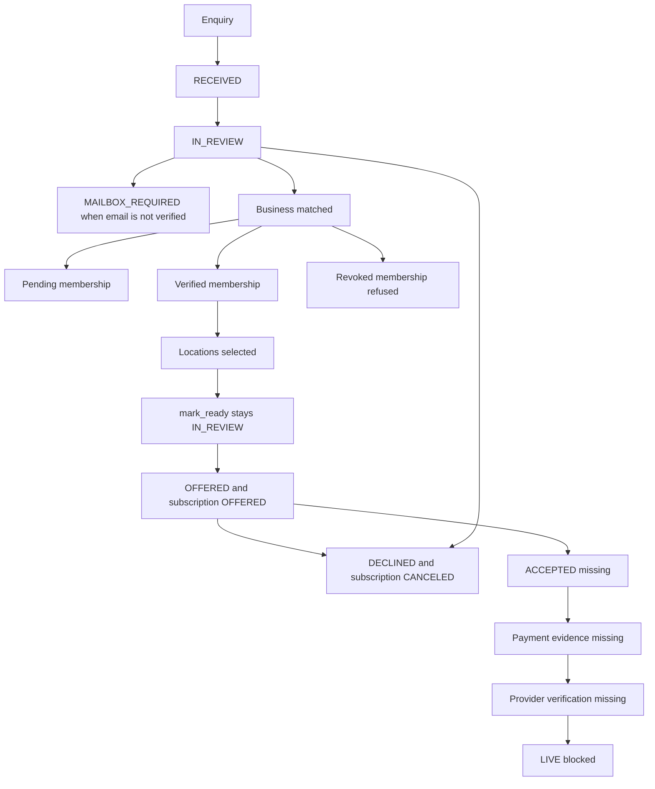

# 03A-01 Customer onboarding progress

Read-only. A signed-in customer can see the progress of their own Telloya or Complete onboarding request. This phase does not accept an offer, collect money, create an entitlement, or activate a service.

## Current commercial path

Admin commands in `admin_commercial_command_v1` are the only writers for an onboarding request:



```text
enquiry
  classify -> onboarding_requests RECEIVED
  review -> IN_REVIEW
  match_customer -> IN_REVIEW, or MAILBOX_REQUIRED when email is not verified
  match_business -> pending or verified membership; revoked is refused
  select_locations -> selected location ids; request state unchanged
  mark_ready -> IN_REVIEW or MAILBOX_REQUIRED, plus a mark_ready event
  prepare_offer -> request OFFERED and a commercial subscription OFFERED
                 when one approved priced plan exists
  decline -> DECLINED; an OFFERED subscription is withdrawn to CANCELED
```

`customer_portal_products_v1` does not read `onboarding_requests`. An offer, a draft, and an enquiry are not a purchase in that projection. It requires a verified business membership.

These request states exist on the table and have no writer in the current commands: `INVITED`, `AWAITING_PAYMENT`, `PROVISIONING`, `READY`, `CLOSED`. `mark_ready` does not set `INVITED`. Invitation dispatch updates `updated_at` only.

Customer acceptance of a commercial offer is a later command. This progress read does not itself move a subscription from `OFFERED` to `ACCEPTED`.

Payment evidence has a table. Nothing in this onboarding path writes it. The customer progress read reports a payment stage only when `AWAITING_PAYMENT`, `PAYMENT_PENDING`, or a payment-evidence row is already stored, and it never returns the provider event id or an amount.

Provider verification is not implemented. `service_provisions.state` cannot be `LIVE` while `service_provisions_live_closed` is in force. Ready for use is returned only when a Telloya provision is `LIVE` and the profile, agent, number, forwarding, customer confirmation, provider binding, passed provider test, and `live_at` are all stored. A Complete request does not create Guard coverage.

DEV still has no approved `plan_versions`, no commercial subscriptions, no product entitlements, and no service provisions. `prepare_offer` therefore cannot produce an offer until a real approved plan exists. This phase does not seed one.

## Customer read

`public.customer_portal_onboarding_status_v1(p_token_hash text)` is service-role only. The private function resolves the customer from `customer_portal_session_v1`. Invalid, expired, idle, and signed-out sessions return null.

Pending membership returns the product and the verification stage, with no business name and no locations. Revoked membership returns a limited review line and withholds the business, locations, offer, and provision. Requests are ordered by `created_at`, then id. Another customer's request is not returned.

My Products keeps Recovery and Guard as they are. While `CUSTOMER_ONBOARDING_STATUS_READ_ENABLED` is exactly `true`, an open Telloya or Complete request adds a compact status and Track setup. A closed or declined request stays in history and uses View previous request. It does not place an otherwise unsubscribed Telloya under Your services. An existing Active, Pilot, Pending, Setup, Ready for provider verification, Partially active, Status varies by location, Suspended, Expired, or Cancelled status is kept, with its per-location lines and access. A failed onboarding read is unconfirmed only when the commercial read is already unavailable, or the only known value is Not subscribed. It is not shown as Not subscribed, and onboarding progress alone never becomes Active. There is no Telloya dashboard and no Open dashboard from this request.

`/portal/onboarding` is a neutral page. It uses the same portal session, the products hub gate, and the onboarding read flag. With the flag off it returns to My Products and does not query the function. It does not use the Recovery navigation.

The migration `20261103120000_customer_portal_onboarding_status_v1` remains applied on DEV. When it was applied, the verified DEV ledger contained 98 entries and ended there. The current verified DEV ledger contains 99 entries and ends at `20261103140000`. Do not replay `20261103120000` and do not apply it to Production. `20261102200000_telloya_enquiry_infrastructure_v1` remains applied. The previous ledger contained 97 entries and ended there. A provision advances only the request whose commercial subscription and selected locations own it. An offered subscription is Offer prepared and completes Offer recorded. A request marked OFFERED with no linked subscription is Offer being prepared and does not complete Offer recorded. ACTIVE or PROVISIONING can show Service setup and does not complete Service setup recorded unless a matching provision has left NOT_STARTED. Ready for use still requires verified LIVE evidence at every selected location. Recorded payment evidence is Payment recorded, not Awaiting your payment.

## Later phases

03A-02 records customer acceptance of an eligible Telloya or Complete offer. The request stays `OFFERED`. The accepted stage comes from the linked subscription and the immutable acceptance row. See `03A-02-offer-acceptance.md`.

03A-03 payments need a commercial payment record of their own. Recovery guided checkout and standalone Guard billing stay separate. The progress read can say a payment was recorded only from `commercial_payment_evidence` while the request is `AWAITING_PAYMENT` or the subscription is `PAYMENT_PENDING`. It must not return Stripe ids or amounts, and it must not offer a payment button.

03A-04 provider provisioning needs a command that fills `service_provisions` and, only with the operational evidence above, is allowed to leave `LIVE`. That also means retiring `service_provisions_live_closed` in that later migration, not in this one. Complete still must not create Guard coverage.
